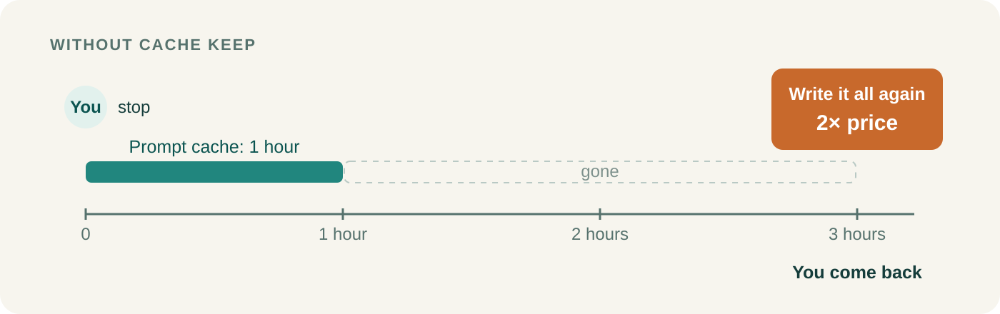
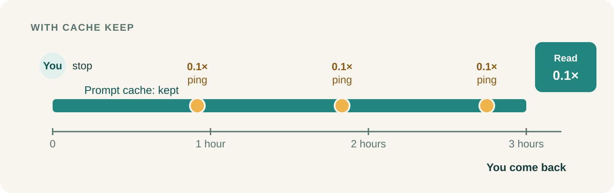
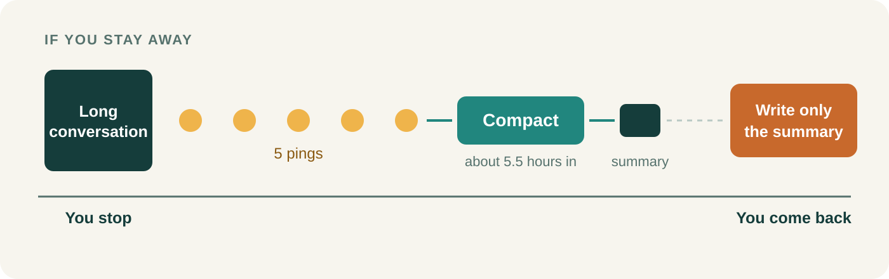

<p align="center">
  
</p>

<h1 align="center">Cache Keep</h1>

<div align="center">

[](https://github.com/game-dev-rta-club/cache-keep/actions/workflows/ci.yml)
[](https://github.com/game-dev-rta-club/cache-keep/releases/latest)
[](LICENSE)

</div>

**Step away from a long Claude Code conversation without paying to load it all again.**

A Claude Code plugin. It works by itself while your conversation sits idle; there is nothing to call.

## The problem: an hour away costs a full rewrite



Every message you send carries the whole conversation to the model. Claude Code keeps what the model has already read in a **prompt cache**: reading from there costs a tenth of the normal input price, but the cache lasts only an hour. Come back after that, and your next message pays **twice** the normal price to write the whole conversation into the cache again: a full **rewrite**.

## The fix: a small ping before the hour is up



Every 55 minutes you are away, Cache Keep sends a **ping**: one small request in the background that reads the conversation from the cache, which keeps the cache for another hour, so a message within that hour reads it at a tenth of the price instead of rewriting it. A ping costs a twentieth of a rewrite, and your conversation does not change. In a test, a ping read 54,960 tokens from the cache and wrote just 83.

## If you stay away: compact, then stop



After five pings, about five and a half hours in, Cache Keep **compacts** the conversation, as Claude Code's `/compact` does: a summary replaces it, so when you come back there is far less to write again. If that would not make it much smaller, it sends one last ping instead. Then it stops until your next message.

## What it saves: an estimate


For the chart's 300k-token conversation, 10 hours away costs 37% less with Cache Keep, as does any absence that outlasts the compaction. The bigger the conversation, the more it saves: about 21% at 200k tokens, 50% at 500k; over 200k needs a model with the 1M-token context window. Below about 140k tokens, coming back after the compaction costs more with Cache Keep than without.

<details>
<summary>How this is estimated</summary>

Prices are taken relative to the normal input price, as Anthropic lists them: writing to the one-hour cache costs 2×, reading from it 0.1×, output 5×. A ping reads the conversation (0.1×). The compaction reads it too and writes a summary of about 13k tokens as output (5×); one real compaction took a conversation from 310,523 tokens to 65,219, and the estimate assumes every conversation compacts to 65k: the summary plus the system prompt and tools, which compaction keeps. Your first message back writes what is left into the cache (2×): the whole conversation without Cache Keep, the 65k with it. [scripts/estimate.mjs](scripts/estimate.mjs) draws the chart from these numbers.

</details>

## Install and use

```sh
npx skills@latest add game-dev-rta-club/cache-keep \
  --skill cache-keep \
  --agent claude-code \
  --global --yes
```

Cache Keep runs in every conversation you start afterwards. To use it in one project only, run the command from that project without `--global`.

**Requires:** Claude Code with plugin support (tested with 2.1.308), and Node.js, npm and Git to install.

**Only with the one-hour cache.** Cache Keep saves money only while Claude Code keeps conversations in the one-hour prompt cache. If yours uses the five-minute cache instead, every ping writes the conversation again and Cache Keep costs more than it saves. To check, read the log after the first ping (below): a few tokens written means the one-hour cache held; the whole conversation written means the five-minute one, so turn Cache Keep off (`enabled` below).

## Settings

Change the settings with `/plugin configure cache-keep@skills-dir` in Claude Code, or in your `~/.claude/settings.json`:

```json
"pluginConfigs": {
  "cache-keep@skills-dir": {
    "options": { "enabled": true, "pingMinutes": 55, "pings": 5, "compactBelowPercent": 60 }
  }
}
```

| Option | Default | What it sets |
| --- | --- | --- |
| `enabled` | `true` | Cache Keep on or off |
| `pingMinutes` | `55` | Idle minutes before each ping; the cache lapses at 60 |
| `pings` | `5` | Pings before Cache Keep decides whether to compact |
| `compactBelowPercent` | `60` | Compact only when the compacted conversation would be under this share of the current one, in tokens |

Whichever way you installed it, Claude Code loads it from your skills folder as the plugin `cache-keep@skills-dir`, and the settings are per user. A change applies from the next conversation.

## Check that it works

Each conversation has a log in `~/.claude/cache-keep/`, named by its session ID:

```text
2026-10-29T01:42:20.209Z holding the conversation open (task b5pynhfh4, sleep 45360)
2026-10-29T02:37:13.489Z ping 1: 54960 tokens read from the cache, 83 written
```

## Good to know

- **Nothing is sent once an hour has passed,** for example after your computer wakes from sleep: the cache is already gone, and a ping would only pay to write it again.
- **In Claude Desktop,** which closes idle conversations when memory runs short, Cache Keep keeps the conversation open with a background `sleep` (the first log line above) and stops it when the pings are done.
- **If you use [chill-agent](https://github.com/game-dev-rta-club/chill-agent),** it already runs Cache Keep in its projects; do not install this one there as well.

## Update

Rerun the install command to update; nothing updates on its own. See the [release notes](CHANGELOG.md).

<details>
<summary>Install a specific release</summary>

```sh
npx skills@latest add https://github.com/game-dev-rta-club/cache-keep/tree/v0.0.5/skills/cache-keep \
  --agent claude-code --global --yes
```

</details>

## Project

[Game Dev RTA Club](https://github.com/game-dev-rta-club) · [MIT](LICENSE) · [Contributing](CONTRIBUTING.md) · [Code of Conduct](CODE_OF_CONDUCT.md) · [Security](SECURITY.md)
