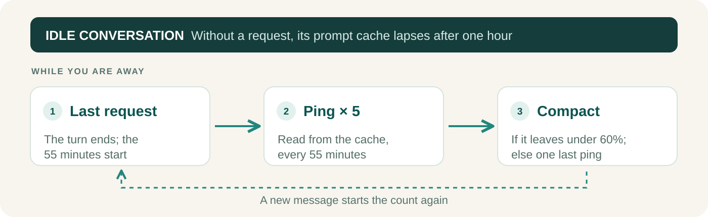

<p align="center">
  
</p>

<h1 align="center">Cache Keep</h1>

<div align="center">

[](https://github.com/game-dev-rta-club/cache-keep/actions/workflows/ci.yml)
[](https://github.com/game-dev-rta-club/cache-keep/releases/latest)
[](LICENSE)

</div>

**Come back to a long Claude Code conversation without paying to cache it all again.**

A Claude Code plugin that keeps an idle conversation's prompt cache warm, then compacts the conversation if you stay away. It works on its own in every conversation; there is nothing to call.

## Why it pays

Claude Code keeps a conversation in a prompt cache that lasts an hour. Come back after more than an hour, and your next message writes the whole conversation into the cache again, at twice the price of plain input.

A ping reads the conversation from the cache instead, at a tenth of the input price: a twentieth of writing it again. In a test, a ping after 55 idle minutes read 54,960 tokens from the cache and wrote 83.

Come back within an hour of any ping, and there is nothing to rewrite. Come back after the compaction, and the rewrite is smaller. Never come back, and the pings have cost about a quarter of one rewrite, plus the compaction.

## What happens while you are away



- **A ping is not a turn.** It is one background request that reads the conversation from the cache. Your transcript, your hooks and the model's context stay as they were. Your next message starts the count again.
- **After five pings, Cache Keep decides.** At the sixth 55-minute mark, about five and a half hours in, it compacts the conversation if that leaves under 60% of it, so the cache you come back to costs less to write; otherwise it sends one last ping. Either way it then stops.
- **Nothing is sent once an hour has passed,** for example after your computer wakes from sleep: the cache has lapsed by then, and a ping would pay to write it all again.
- **In Claude Desktop,** which closes idle conversations when memory runs short, Cache Keep keeps the conversation open with a background `sleep`, longer than the pings so it never ends first, and stops it when the pings are done.

## Install and use

```sh
npx skills@latest add game-dev-rta-club/cache-keep \
  --skill cache-keep \
  --agent claude-code \
  --global --yes
```

Cache Keep runs in every conversation you start afterwards. To use it in one project only, run the command from that project without `--global`.

**Requires:** Claude Code with plugin support (tested with 2.1.308); Node.js, npm and Git to install. Cache Keep saves money only while Claude Code keeps your conversations in the one-hour prompt cache. With the five-minute cache, every ping writes the conversation again and Cache Keep costs more than it saves. Read the log after the first ping (see below): a few tokens written means the one-hour cache held; the whole conversation written means the five-minute cache, so turn Cache Keep off (`enabled: false`). If you use [chill-agent](https://github.com/game-dev-rta-club/chill-agent), it already runs Cache Keep in its projects; do not install this one there as well.

## Settings

Change the settings with `/plugin configure cache-keep@skills-dir` in Claude Code, or in your `~/.claude/settings.json`:

```json
"pluginConfigs": {
  "cache-keep@skills-dir": {
    "options": { "enabled": true, "pingMinutes": 55, "pings": 5, "compactBelowPercent": 60 }
  }
}
```

| Option | Default | What it sets |
| --- | --- | --- |
| `enabled` | `true` | Cache Keep on or off |
| `pingMinutes` | `55` | Idle minutes before each ping; the cache lapses at 60 |
| `pings` | `5` | Pings before Cache Keep decides whether to compact |
| `compactBelowPercent` | `60` | Compact only when the compacted conversation would be under this share of the current one, in tokens |

Whichever way you installed it, Claude Code loads it from your skills folder as the plugin `cache-keep@skills-dir`, and the settings are per user. A change applies from the next conversation.

## See what it did

Each conversation has a log in `~/.claude/cache-keep/`, named by its session ID:

```text
2026-10-29T01:42:20.209Z holding the conversation open (task b5pynhfh4, sleep 45360)
2026-10-29T02:37:13.489Z ping 1: 54960 tokens read from the cache, 83 written
```

## Update

Rerun the install command to update; nothing updates on its own. See the [release notes](CHANGELOG.md).

<details>
<summary>Install a specific release</summary>

```sh
npx skills@latest add https://github.com/game-dev-rta-club/cache-keep/tree/v0.0.1/skills/cache-keep \
  --agent claude-code --global --yes
```

</details>

## Project

[Game Dev RTA Club](https://github.com/game-dev-rta-club) · [MIT](LICENSE) · [Contributing](CONTRIBUTING.md) · [Code of Conduct](CODE_OF_CONDUCT.md) · [Security](SECURITY.md)
